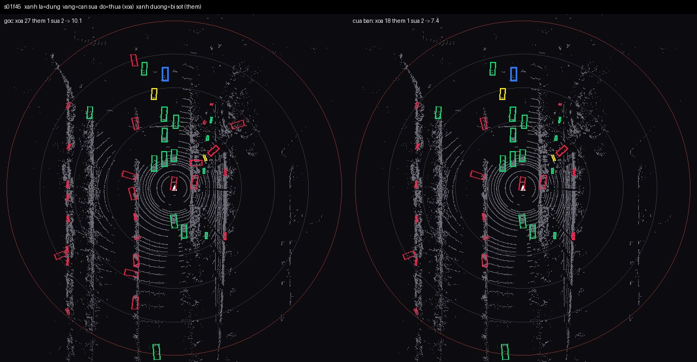

# Báo cáo Day 14 — Đoàn Tùng Lâm — 2A202603227

- Mã học viên dùng với `--student`: `227`
- `seed_tag` trong `frames_A.txt`: `393590736f`

## 1. Dự đoán trước sweep (bước 5b)

Ghi **trước** khi chạy `scripts/pp_sweep.py`, rồi commit và push ngay (lịch sử commit là bằng chứng thời điểm viết). Không sửa phần này sau khi có kết quả.

- Tham số tôi nghĩ giảm công sửa nhiều nhất: `score_thr` tăng từ 0.1 lên khoảng 0.4, kèm `min_points=5`. Tôi dự đoán `score_thr` đóng góp phần lớn mức giảm, còn `min_points` chỉ giảm thêm một ít.
- Vì sao: sau khi sửa tay tập A, cấu hình gốc (`score_thr=0.1`, `min_points=0`) cho 108 box, trong đó 56 box phải xóa, 3 box phải thêm và 8 box phải sửa, chi phí 23.8. Riêng phần xóa đã là 56 × 0.3 = 16.8, khoảng 70% tổng chi phí, còn phần thêm chỉ 3 × 1.0 = 3.0. Tức là model thừa box nhiều hơn hẳn sót box. Ở ngưỡng 0.1 model giữ cả các box điểm tin cậy thấp, và model gán nhiều Cyclist (17 box ở s01f45, 29 box trên cả 3 frame), nhiều khả năng là nhiễu trên bụi cây và lề đường. Tăng `score_thr` và đặt `min_points` sẽ loại phần lớn số box này, nên chi phí xóa giảm mạnh. Rủi ro tôi thấy: lọc quá tay sẽ làm mất cả box thật (xe ở xa, người đi bộ ít điểm), khi đó mỗi box thật bị mất phải thêm lại với giá 1.0 thay vì 0.3, nên tôi không đoán mức lọc cao nhất (0.5) là tốt nhất.

## 2. Tập A: sửa tay và tune

| Cấu hình | Xóa | Thêm | Sửa | Chi phí |
|---|---:|---:|---:|---:|
| Gốc | 56 | 3 | 8 | 23.8 |
| `best_config.json` | 36 | 4 | 8 | 18.8 |

- Tham số đã đổi trong `best_config.json`: `score_thr` 0.1 → 0.4 và `min_points` 0 → 10. Các tham số còn lại giữ mặc định.
- Kết quả leave-one-out (các dòng `scripts/pp_sweep.py` in ra):
  ```
  s01f45: cấu hình chọn {'score_thr': '0.4', 'min_points': '10'} → 7.4 (tốt nhất có thể 7.4)
  s02f34: cấu hình chọn {'score_thr': '0.4', 'min_points': '10'} → 5.5 (tốt nhất có thể 5.5)
  s05f12: cấu hình chọn {'score_thr': '0.4', 'min_points': '10'} → 5.9 (tốt nhất có thể 4.9)
  ```
- Cấu hình có ổn định trên từng frame không? Vì sao tôi vẫn chọn nó: Khi bỏ lần lượt từng frame, cả ba lần đều chọn lại đúng `score_thr=0.4`, `min_points=10`, nên lựa chọn không phụ thuộc vào riêng frame nào. Hai frame s01f45 và s02f34 đạt đúng mức tốt nhất có thể. Riêng s05f12 kém 1.0 so với mức tốt nhất (5.9 so với 4.9). Cụ thể ở s05f12, số box xóa giữ nguyên là 8 nhưng số box thêm tăng từ 2 lên 3, tức là bộ lọc làm mất thêm một vật thật mà không loại được hộp thừa nào. Tôi vẫn chọn cấu hình này vì tổng chi phí giảm từ 23.8 xuống 18.8 và `score_thr=0.4` cho kết quả tốt hơn rõ rệt so với 0.3 (21.7) và 0.5 (23.1). Mức 0.5 xóa ít hộp hơn (22) nhưng phải thêm 13 hộp bị lọc mất. Tuy vậy chỉ có 3 frame nên kết luận này chưa chắc vững khi sang tập B. Hai mức `min_points` 0 và 5 cho kết quả gần như như nhau (19.1), còn 10 chỉ hơn 0.3.

## 3. Trước/sau (bước 8)



- `scripts/pp_compare.py` báo cấu hình đã chọn giảm **21%** công sửa trên tập A (23.8 → 18.8). Theo frame: s01f45 10.1 → 7.4, s02f34 8.8 → 5.5, s05f12 4.9 → 5.9 (tăng).
- Dự đoán ở mục 1 đúng hay sai? Phần lớn đúng, có một chỗ lệch nhẹ.
  - Đúng: tôi dự đoán `score_thr` quanh 0.4 giảm công sửa nhiều nhất và mức 0.5 không phải tốt nhất. Kết quả sweep cho `score_thr=0.4` thấp nhất, còn 0.5 cho 23.1 vì phải thêm 13 hộp bị lọc mất.
  - Đúng: tôi dự đoán mức giảm đến từ việc bớt hộp thừa. Số hộp xóa giảm từ 56 xuống 36 (giảm 20 hộp, khoảng 6.0 điểm), trong khi số hộp thêm chỉ tăng từ 3 lên 4 (tăng 1.0 điểm), nên chi phí giảm ròng 5.0 điểm. Số hộp sửa giữ nguyên là 8.
  - Lệch: tôi dự đoán `min_points=5`, nhưng tốt nhất là `min_points=10`. Chênh lệch chỉ 0.3 điểm (19.1 so với 18.8), phù hợp với dự đoán rằng `min_points` chỉ đóng góp một ít.
  - Điều tôi chưa dự đoán được: ở s05f12, bộ lọc làm chi phí tăng 1.0 vì mất một vật thật. Trong ảnh s01f45, các hộp đỏ (thừa) vẫn còn khá nhiều ở cả hai cấu hình, cho thấy bộ lọc chỉ loại được một phần hộp thừa.

## 4. Tập B

Số đo từ `scripts/pp_prelabel.py --frames d14_227/frames_B.txt --config d14_227/best_config.json --gt d14_227/ref_B.json`:

| Xóa | Thêm | Sửa | Chi phí |
|---:|---:|---:|---:|
| 83 | 26 | 21 | 61.4 |

Model dự đoán 207 box, nhãn tôi sửa xong có 150 box, và 124 box khớp nhau (BEV IoU ≥ 0.3). Chi phí từng frame dao động từ 1.3 (s04f47) đến 9.8 (s05f43).

- Loại box tốn công sửa nhất ở tập B:
  - **Theo tổng điểm chi phí**, thao tác tốn nhất là *thêm* box bị sót: 26 box × 1.0 = 26.0 điểm, nhỉnh hơn *xóa* (83 × 0.3 = 24.9) và nhiều hơn hẳn *sửa* (21 × 0.5 = 10.5), dù số box thêm chỉ bằng khoảng một phần ba số box xóa.
  - **Box thừa bị xóa** chủ yếu là Car (60 box) và Cyclist (20 box), cả hai đều chủ yếu nằm trên bụi cây, hàng rào và xe đạp hoặc xe máy đỗ không người lái. Trong tập B model gần như không sinh được Pedestrian thật nên chỉ có 3 box Pedestrian bị xóa.
  - **Box bị sót phải thêm** gồm Car (8), Cyclist (6), Pedestrian (5), Bus (4) và Truck (3). Bus và Truck chiếm 7 trong 26 box thêm mà model KITTI không có hai lớp này, nên đây là nhóm model hầu như không bao giờ tự đề xuất đúng.
  - **Box phải sửa** chủ yếu là sai kích thước hoặc hướng (14 box), rồi lệch tâm (6 box), và chỉ 1 box phải đổi lớp (Car → Truck). Frame tốn nhất là s05f43 (6 xóa, 6 thêm, 4 sửa, chi phí 9.8), một ngã tư đông xe với nhiều xe van, xe tải và xe máy.

## 5. Giới hạn

- **Chỉ 3 frame để tune.** Cấu hình `score_thr=0.4`, `min_points=10` được chọn trên 3 frame tập A. Leave-one-out cho thấy s05f12 kém mức tốt nhất 1.0 (5.9 so với 4.9), và chi phí frame này còn tăng so với cấu hình gốc (4.9 → 5.9). Vì vậy tôi không khẳng định mức giảm 21% trên tập A sẽ giữ nguyên ở tập B. Tôi cũng không đo tập B bằng cấu hình gốc nên không có số so sánh trước/sau trên tập B.
- **Model KITTI không có Truck và Bus.** Model chỉ nhận Car, Cyclist, Pedestrian; luật đổi lớp theo kích thước chỉ cứu được một phần. Trong tập B vẫn có 7 box Bus hoặc Truck phải thêm tay hoàn toàn, và xe buýt hay bị cắt thành vài box Car nhỏ.
- **Chi phí là công thức do đề đặt, chưa phải thời gian sửa thật.** Trọng số 0.3/1.0/0.5 chưa được đo bằng thao tác thật của tôi. Tôi không kết luận số giờ công đã tiết kiệm.
- **Nhãn tham chiếu do một người sửa.** `ref_A.json` và `ref_B.json` là nhãn của riêng tôi, chưa có người thứ hai kiểm. Vật xa, ít điểm hoặc bị che có thể bị sót hoặc sai lớp, nên chi phí đo ra phụ thuộc vào ranh giới tôi tự chọn.
